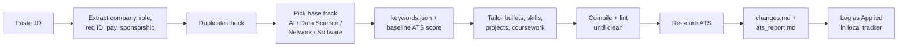

# job-tracker

**Paste a job description, get a tailored one-page resume.**

`job-tracker` is a Claude Code workspace that turns one pasted job posting into a resume
tailored for that job. The resume is ATS-checked, compiled to PDF and logged in a private
application tracker. The LaTeX layout stays locked. Only bullets, skills, projects and
relevant coursework change, and every change comes from your own master resumes. Nothing is
invented.

```
You:    <paste a job description>
Claude: ✅ Acme Robotics — Controls Intern · base: software · logged Applied (APP-0007)
        ATS: 76 → 79 · required 14/16 · lint: 0 errors
        Changes: led with anomaly detection (fault detection), added PID tuning + RL bullets ...
        Coursework: Kalman Filtering, Probability and Statistics, Stochastic Processes, ...
        Gaps: Simulink, numerical optimization
        PDF: applications/2026-10-24_acme-robotics_controls-intern/resume.pdf
```

---

## Why

Tailoring a resume for every application takes 30–60 minutes of moving bullets around,
checking keywords and fixing LaTeX wraps. This repo cuts that to about 2 minutes. It also
keeps two guarantees that matter more than speed:

- **No fabrication.** Every skill, number, title and date comes from the files in `resumes/`.
  Missing JD keywords are reported as *Gaps* and are never added. An honest 72 beats a made-up 95.
- **Layout locked.** Preamble, header, Education, section order, spacing, margins and fonts are
  never touched. The resume stays exactly one page, and every bullet fits on one line.

---

## How it works



| Step | What happens | Tool |
|---|---|---|
| 1. Read the job | Pulls out company, role, req ID, location, pay and sponsorship. Unknown fields stay blank; IDs and salary are never guessed. | Claude |
| 2. Duplicate check | Flags a job you've already applied to (same company + req ID / role). | `scripts/tracker.py exists` |
| 3. Pick a base | Chooses one of four master resumes by job title first, then required skills. | `scripts/new_application.py` |
| 4. Baseline score | Writes required/preferred keywords with aliases and scores the untouched master. | `scripts/ats_score.py` |
| 5. Tailor | Reorders and rewrites bullets in the JD's vocabulary, swaps in better bullets and projects from the bank, reorders skills, and picks relevant coursework. | Claude + `bullet_guidelines.md` |
| 6. Build + lint | Compiles with pdflatex. Checks one page, no wrapped bullets, strong verbs, no pronouns and LaTeX escaping. Repeats for up to 5 rounds. | `scripts/build_resume.py`, `scripts/lint_bullets.py`, `resumes/page_fill.py` |
| 7. Re-score | Scores the tailored resume against the same keywords, so before/after is apples to apples. | `scripts/ats_score.py` |
| 8. Records | Writes an audit log of every edit (before, after, why, rule) plus an ATS report with gaps. | Claude |
| 9. Track | Adds a row to the tracker with status `Applied` and a follow-up date 14 days out. | `scripts/tracker.py add` |

---

## Features

- **Four resume tracks:** `ai`, `datascience`, `network` and `software`, plus a
  `projects_bank.tex` of extra projects, bullets and coursework to pull from.
- **Deterministic ATS scorer:** Claude makes one judgment call per job (writing
  `keywords.json`), and a plain Python scorer does the rest, so scores are reproducible:

  | Component | Weight |
  |---|---|
  | Required keywords (with aliases) | 50 |
  | Preferred keywords | 20 |
  | Job title match | 10 |
  | Format (standard sections, parseable text) | 20 |

- **Real one-line check:** `lint_bullets.py --pdf` measures actual line wraps in the
  compiled PDF with `pdftotext`, not character counts. It catches orphan second lines and
  bullets that only just fit.
- **Bullet linter:** enforces past-tense action verbs, bans weak openers ("Responsible for",
  "Helped", "Utilized"), limits any opener to twice per page, bans pronouns, catches LaTeX
  escaping mistakes (`%`, `&`, `#`, `_`) and warns when bullets lack a number.
- **Page-fill meter:** `page_fill.py` asks LaTeX how much vertical space is left and
  converts it to "bullet lines". The page ends up full, not short and not spilling over.
- **Overleaf-safe preview build:** if your local TeX lacks a package, `preview_build.py`
  swaps in metric-compatible stand-ins, so wraps can still be measured.
- **Application tracker:** a CSV pipeline (Applied → OA → Interview → Offer …) with
  duplicate detection, status notes and follow-up reminders via the `/status` skill.
- **Full audit trail:** each application folder keeps the JD, keywords, tailored `.tex`,
  PDF, a change table and an ATS report, so you can prep for an interview from exactly what you sent.

---

## Repository layout

```
job-tracker/
├── CLAUDE.md / AGENTS.md          # Project rules the agent always follows
├── GUIDE.md                       # Step-by-step setup guide (~45 min)
├── .claude/skills/
│   ├── tailor/                    # The full pipeline (SKILL.md + bullet_guidelines.md)
│   └── status/                    # Update / review the application pipeline
├── resumes/                       # Your master resumes (the only source of truth)
│   ├── resume_ai.tex
│   ├── resume_datascience.tex
│   ├── resume_Network.tex
│   ├── resume_software.tex
│   ├── projects_bank.tex          # Extra projects, bullets, coursework
│   └── page_fill.py
├── scripts/
│   ├── ats_score.py               # Deterministic ATS scorer
│   ├── build_resume.py            # pdflatex build + one-page check
│   ├── preview_build.py           # Look-alike build when packages are missing
│   ├── lint_bullets.py            # Bullet + one-line linter
│   ├── new_application.py         # Creates applications/<date>_<company>_<role>/
│   ├── tracker.py                 # Tracker CLI (exists / add / update / list)
│   └── doctor.py                  # Checks your setup
│
│   # Created locally, gitignored (private):
├── applications/<date>_<company>_<role>/
│   ├── jd.md  keywords.json  resume.tex  resume.pdf  changes.md  ats_report.md
├── tracker/applications.csv
└── logs/CHANGELOG.md
```

---

## Quick start

> Full walkthrough with checks for each step: **[GUIDE.md](GUIDE.md)**.

**1. Install:** Python 3.9+, Git, a LaTeX distribution (MacTeX / MiKTeX / texlive-full),
`pdftotext` (poppler) and [Claude Code](https://code.claude.com/docs).

**2. Clone and add your resumes:**
```bash
git clone https://github.com/jaydoshi2/job-tracker.git
cd job-tracker
# Replace the files in resumes/ with your own four tracks + projects_bank.tex
python3 scripts/doctor.py      # shows anything still missing
```

**3. Use it:**
```bash
claude
```
Then paste a job description. That's it. Other commands:

| You type | What happens |
|---|---|
| *(paste a JD)* | Full pipeline, logged as Applied |
| *(paste a JD)* + "just check" | Tailor and score only; nothing logged |
| `/status` | Pipeline summary and follow-ups due |
| `/status Google got an OA` | Moves that application to `OA` with a dated note |

Scripts also run on their own:
```bash
python3 scripts/ats_score.py --keywords applications/<app>/keywords.json --resume resumes/resume_ai.tex
python3 scripts/build_resume.py applications/<app>/resume.tex
python3 scripts/lint_bullets.py applications/<app>/resume.tex --pdf
python3 scripts/tracker.py list --due
```

---

## Writing rules (enforced)

Every bullet follows **STAR thinking, XYZ writing**:

```
[Strong past-tense verb] + [what you built/changed] + [using what tech] + [measurable result]
```

| Weak | Strong (one line) |
|---|---|
| Responsible for fixing bugs in the backend | Resolved 40+ backend bugs in Python, cutting weekly incidents by 30% |
| Worked on machine learning model for predictions | Trained an XGBoost churn model on 500k records, reaching 0.87 AUC |

The full rulebook, with verb tables, banned openers, LaTeX escaping and examples, is in
[`.claude/skills/tailor/references/bullet_guidelines.md`](.claude/skills/tailor/references/bullet_guidelines.md).

---

## Privacy

The repo is public, but your job search isn't. `applications/`, `tracker/` and `logs/`
are in `.gitignore`. The pipeline writes them locally and **never commits or pushes them**,
and commit messages never name a company. Only the tooling (skills, scripts, templates) is shared.

> Forking this? Your `resumes/` folder holds your name and contact details. Keep your
> fork private, or swap in placeholder resumes before pushing.

---

## Built with

[Claude Code](https://code.claude.com/docs) (agent + skills) · Python · LaTeX (pdflatex) ·
poppler `pdftotext` · Git
